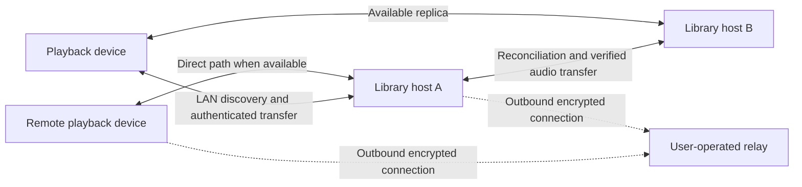

# Cluster connectivity and replication plan

Status: proposed technical plan. Product requirements are agreed in [the cluster model](cluster-model-design.md) and [ADR 0002](adr/0002-local-first-connectivity-with-user-operated-remote-access.md). This document does not authorize deployment or claim that its prototypes have passed.

Research baseline: repository commit `0b8b387`, with upstream documentation checked on 2026-10-10. Concrete dependency versions and platform support must be verified in the implementation spikes below.

## Existing implementation and gaps

| Observed implementation | Consequence for this plan |
| --- | --- |
| Rust assigns a library UUID per data directory and track UUIDs per host. Storage deduplication uses SHA-256 plus suffix ([store.rs](../headless/src/store.rs)). | Add cluster/object/replica identity without replacing existing IDs. Reconcile identical bytes across differing suffixes while preserving usable format metadata. |
| Swift stores one P2P peer, one active transfer client, and a singleton catalog ([LocalTransfer.swift](../apps/macos/LocalTransfer.swift), [CredentialStore.swift](../apps/macos/CredentialStore.swift), [CatalogDatabase.swift](../apps/macos/CatalogDatabase.swift)). | Multiple host connections alone are insufficient; introduce a merged catalog and source selection, and migrate saved registration. |
| Bonjour advertises the existing local TCP protocol; headless P2P has no corresponding local discovery ([LocalTransfer.swift](../apps/macos/LocalTransfer.swift), [main.rs](../headless/src/main.rs)). | Do not assume existing Bonjour automatically discovers headless Iroh endpoints. Test one compatible discovery contract. |
| Rust non-direct mode selects default relays; Swift likewise enables default mode when a peer advertises a relay ([peer.rs](../headless/src/peer.rs), [PeerTransfer.swift](../apps/macos/PeerTransfer.swift)). | Explicit user-supplied relay configuration is required on both sides. |
| The signed directory path currently requires direct-only mode and rejects relayed announcements ([rendezvous.rs](../headless/src/rendezvous.rs)). | Do not combine existing flags and assume custom relay plus directory works. Prefer the independent relay-bootstrap spike first. |
| Rust allows multiple peers through a local file allowlist; CLI enrollment and HTTPS token authorization are separate ([peer.rs](../headless/src/peer.rs), [api.rs](../headless/src/api.rs)). | Add one-use invitation redemption and verifiable cross-host membership. Preserve legacy authorization during migration without treating it as cluster-wide authority. |
| Album choices already have parent revisions, concurrent heads, and resolution UI ([AlbumOrganization.swift](../apps/macos/AlbumOrganization.swift), [OrganizationView.swift](../apps/macos/OrganizationView.swift), [organization.rs](../headless/src/organization.rs)). | Reuse this causal model where appropriate rather than replacing it with clock-based last-write-wins. Imported metadata currently follows separate overwrite rules and needs its own conflict analysis. |
| Catalogs and organization data use schema 2; audio operations do not carry cluster tombstones. Reconnect preserves locally saved entries absent from the remote catalog. | A missing entry cannot mean deletion. Add explicit deletion records and prevent old clients from reintroducing deleted data. Address version 1 and music protocol version 2 are independent version domains. |

These are static inspection findings, not new test results.

## Recommended architecture

Keep Iroh for authenticated encrypted transport and existing verified audio transfer. Use local discovery for LAN connectivity, a user-supplied Iroh relay for optional remote connectivity, SQLite for durable cluster state, and explicit reconciliation of stored changes for synchronization. Evaluate `iroh-gossip` as a change-notification mechanism, never as the authoritative catalog, authorization store, or proof of successful audio storage.

The relay is not a library host. It does not decide cluster membership or store the authoritative library. Local operation remains independent of it.

## Technology comparison

| Area | Recommendation | Alternatives and trade-off |
| --- | --- | --- |
| Transport | Retain Iroh and the current audio protocol initially | Replacing transport adds migration work without resolving cluster identity, authorization, or conflicts. |
| LAN discovery | Compatible mDNS/DNS-SD across supported platforms | Do not equate Apple's Bonjour implementation with an Apple-only protocol. Verify the actual record format and mobile lifecycle; similarly named mDNS libraries may not interoperate. |
| Remote access | Explicit custom Iroh relay configuration, direct path preferred | Public default relays would introduce an implicit third-party dependency. Direct-only mode remains useful but cannot guarantee reachability. |
| Peer addressing | Try stored endpoint IDs plus custom relay URLs first; LAN discovery supplies local candidates | Keep the existing signed directory optional during migration. Avoid requiring a separate directory if the relay-based bootstrap experiment passes. |
| Durable state | Extend SQLite with cluster membership, changes, locations, jobs, and conflicts | XML/JSON remain useful for interchange, but replacing transactional local storage with text files does not solve reconciliation. |
| Notifications | Assess `iroh-gossip` after durable reconciliation works | For two hosts, reconnect-time and periodic reconciliation can establish correctness without gossip. Gossip later reduces notification delay and supports more hosts. |
| Replicated documents | Do not adopt `iroh-docs` wholesale in the first milestone | Its replica model, redb storage, and blobs/gossip dependencies need separate mapping to existing SHA-256 identity, SQLite, and explicit user conflict resolution. |

Iroh 1.3 provides configurable relay and address-lookup services, plus port-mapping configuration. Build local-only endpoints without implicit public services; audit the actual Swift binding options as well as Rust. Remote mode adds only the user's configured relay, without falling back silently to a public default. See [Iroh Builder](https://docs.rs/iroh/latest/iroh/endpoint/struct.Builder.html) and [Minimal preset](https://docs.rs/iroh/latest/iroh/endpoint/presets/struct.Minimal.html).

Iroh relays support connection establishment and NAT traversal as well as carrying encrypted traffic. The product should prefer direct transfer but must not promise that zero application bytes traverse a relay before a direct path is found. A reachable relay is still required for this optional bootstrap route; home-router manual forwarding is not required by the proposed topology, while the VPS operator must expose the relay's required services. See [NAT traversal](https://docs.iroh.computer/concepts/nat-traversal) and [self-hosting](https://docs.iroh.computer/iroh-services/relays/self-hosted).

Iroh's local-lookup documentation states that global publication of IP addresses is not required for hole punching after a relay connection is established. Its mDNS implementations use different formats. These facts support a directory-optional prototype, not an untested claim about the existing Swift client. See [local address lookup](https://docs.iroh.computer/connecting/local-address-lookup) and [EndpointAddr](https://docs.rs/iroh/latest/iroh/struct.EndpointAddr.html).

`iroh-gossip` broadcasts messages to topic participants and needs bootstrap peers. Its checked manifest (`0.101.0`) accepts Iroh major version 1; this is manifest compatibility, not a successful build or Apple binding proof. Reconciliation must recover after missed notifications and offline periods. See [gossip behavior](https://docs.iroh.computer/connecting/gossip) and [manifest](https://docs.rs/crate/iroh-gossip/latest/source/Cargo.toml).

`iroh-docs` offers signed multi-author replicas and set reconciliation, with content addressed separately and persistent storage based on redb. This is useful functionality, but it does not by itself specify Syncstr's user-facing conflict decisions or membership revocation. See [iroh-docs](https://docs.rs/iroh-docs/latest/iroh_docs/).

## State boundaries

Proposed records, not a finalized schema:

- **Cluster identity**: stable group identity, independent of a host's current catalog ID or IP address.
- **Member**: device public key, display name, host capability, and authorized membership history. Do not use one copied private key for all hosts.
- **Audio object**: complete-file SHA-256 and length. Different encodings or tag-modified bytes remain distinct.
- **Library metadata**: retain existing album IDs, imported metadata, and user overrides; associate them with cluster objects without flattening conflicting values.
- **Replica location**: object, member, verification status, and freshness. A catalog listing or online announcement is not a durable-storage receipt.
- **Change record**: unique identity, author, causal predecessors, operation, and authenticity evidence. Device wall-clock timestamps are diagnostic, not the winner-selection rule.
- **Transfer job**: persisted intended source/destination, object, retry state, and verified completion. Initially retry interrupted whole-file transfers unless resumable transfer is justified separately.
- **Conflict**: competing changes and a later explicit user resolution that references them. Do not destroy either candidate while unresolved.

Use a bounded, paginated exchange of missing change records on connect and periodically while connected. Deduplicate replays and tolerate reordered delivery. A gossip notification can advertise that reconciliation is needed; receivers fetch and validate actual records. All paths must apply the same authorization checks, including gossip/bootstrap paths.

Send a storage receipt only after the receiver verifies the full file, publishes it durably, and commits its location state. Define crash consistency and storage-flush requirements before relying on receipts to offer local removal. A single confirmed host copy enables the agreed batch prompt; it is not a guarantee against later disk failure. Losing or changing a replica must update availability.

For an ordinary stale replica, apply the known deletion. If a deletion competes with an explicit re-addition, preserve the alternatives and ask the user. Retain deletion knowledge until safe compaction is proven; a disconnected member must not silently resurrect files.

## Enrollment and membership

The initial invitation flow is LAN-local: the host issues a random expiring one-use invitation, the client pins the expected host identity from the invitation, and an encrypted enrollment exchange binds the invitation to the client's key. Consume invitations atomically, reject replay, and keep invitation secrets out of discovery announcements and logs. QR and pasted links carry the same payload.

Recommend a separate enrollment protocol from ordinary music access. It may accept an unenrolled device only for enrollment, without exposing the catalog or allowing uploads. Successful enrollment supplies cluster membership and remote bootstrap settings. Do not treat a QR containing only an address as authorization.

Membership approval by one host must be verifiable by another. Define signed host-issued grants, host-role authorization, revocation, and replay validation before implementing cross-host trust. An offline host cannot immediately know a new revocation. User conflict prompts must not grant access to an unverified or disputed member while a decision is pending; this is a proposed security behavior to validate in the protocol specification.

## Implementation sequence and acceptance gates

### M0: Verify connectivity choices

Local experiment results and outstanding gates are tracked in [M0 connectivity experiments](cluster-connectivity-m0.md).

Create isolated, disposable experiments before changing production behavior:

1. Rust headless and Apple client use the same custom relay with no public default lookup or relay. Test endpoint ID plus relay URL with no directory and no stored direct IP.
2. Establish connection, observe whether the path is direct or relayed, transfer and hash-check a fixture. Block direct UDP in a test environment to prove relay fallback; restore it to observe direct upgrade where supported.
3. With WAN access unavailable, prove LAN discovery and transfer. Check cross-platform mDNS record interoperability and Swift binding availability.
4. Validate a pinned relay release/configuration on a test host: TLS, required ports, WebSocket/proxy handling, restart, health, and relay access restrictions. Do not publish an unrestricted relay template by default.

Gate: choose the concrete relay and discovery integration only from measured results. Existing 4G success with a manual router rule does not satisfy the no-manual-rule gate. No production rule is removed as part of planning.

### M1: Cluster persistence and reversible migration

Add stable cluster/member identities, multiple peer records, object locations, and durable change/job state. Preserve current private keys, authorized pairings, files, album identities, and user overrides. A legacy peer ID does not prove common cluster membership; linking previously separate libraries requires an explicit enrollment/join operation.

Gate: repeated migration is idempotent, interruption leaves recoverable state, existing saved music plays offline, and two locations for identical bytes appear as one item. Preserve originals and backups until end-to-end proof.

Negotiate cluster-protocol capabilities separately from the existing address format. Clients that cannot understand cluster membership, deletions, or conflicts must not participate as automatic replication writers; present an upgrade requirement rather than silently downgrading cluster semantics. Keep legacy library access isolated until its explicit migration is verified.

### M2: LAN enrollment and two-host synchronization

Implement invitation redemption, verifiable cluster authorization, local discovery, missing-record reconciliation, and verified whole-file replication between two headless nodes. Reconcile imported metadata without erasing overrides. Deletion and concurrent-change records must be representable before enabling automatic bidirectional mutation.

Gate: import on either host reaches the other; duplicate delivery is idempotent; restart and offline catch-up work; corrupted or interrupted transfers produce no storage receipt; unknown/revoked members are rejected; deletions do not resurrect. Introduce gossip only if it preserves these results with notifications dropped or duplicated.

### M3: Apple application integration

Replace single-peer/single-catalog assumptions with one cluster library and multiple source locations. Automatically select reachable replicas, retain the offline catalog, and keep local-copy removal distinct from cluster deletion. Add enrollment UI, saved registration restoration, batch keep/remove prompts, cellular policy, and conflict selection. Treat source failure as unavailable, not as catalog deletion.

Gate: two headless hosts plus macOS/iPhone complete import, replication, source failover, download, restart, and offline playback. Verify import batch prompts and partial failure handling, explicit cellular downloads, and conflicting edit/deletion resolution. iOS background execution is tested within OS limits; do not promise continuous background serving.

### M4: Optional remote deployment package

Publish a version-pinned user-operated relay template and instructions, including bootstrap URL export, host/client configuration, access control, health, and upgrade procedure. Provide directory setup only where demonstrated necessary or explicitly selected. A relay is configured once by the cluster administrator and distributed through enrollment.

Gate: physical iPhone on cellular connects and downloads with no manual home-router permission rule in an authorized test setup; forced relay and direct paths are separately observed. Stop the external service and confirm LAN operation continues. Verify that no implicit Syncstr-operated or public Iroh service is contacted.

### M5: Additional application platforms

Reuse the tested wire contract and fixtures for Android and Windows, with platform discovery and secure key storage. Windows can acquire the library-host role; a new role does not create a separate library. Avoid rewriting working Swift components solely for hypothetical reuse; extract shared Rust domain logic when concrete cross-platform implementations justify it.

## Verification and remaining specification work

Reuse the existing transfer/restart/revocation and integrity tests in [peer.rs](../headless/tests/peer.rs), store retry/rollback tests in [node.rs](../headless/tests/node.rs), and causal choice tests in [organization.rs](../headless/tests/organization.rs). Extend the native client integration in [PeerTransferTests.swift](../apps/macos/Tests/PeerTransferTests.swift) and migration coverage in [CatalogMigrationTests.swift](../apps/macos/Tests/CatalogMigrationTests.swift), preserving cross-language fixtures in [contracts.rs](../headless/tests/contracts.rs). Existing one-to-one tests do not constitute two-host replication coverage.

Planning checks are source inspection, upstream documentation comparison, and document consistency only. No new relay deployment, network experiment, schema migration, or application test is claimed by this document.

Before the corresponding implementation milestone, specify membership conflict handling, causal-record format, conflict resolution propagation, partial-batch prompt behavior, host promotion/demotion, and relay configuration rotation. These refine accepted behavior rather than automatically authorizing new product scope. Application file/copy deletion and membership revocation must remain distinct.
